# Virtual SOC Lab — Threat Detection & Incident Response with Wazuh

**Designed, Built and Evaluated a Virtual Security Operations Centre Using Wazuh**

## Overview

This repository documents a virtual Security Operations Centre (SOC) lab developed as part of my BSc (Hons) Cybersecurity degree at Coventry University London.

The project involved designing and deploying a Wazuh-based monitoring environment, connecting Windows and Linux endpoints, generating controlled security events, investigating alerts and performing manual incident response.

The objective was to evaluate how a SIEM platform supports security monitoring, threat detection, investigation and response in a small virtual environment.

**Project outcome:** Successfully deployed a functional SOC lab, collected security telemetry from Windows and Ubuntu endpoints, investigated authentication and account-management activity, and demonstrated manual containment actions. Testing also highlighted limitations in network reconnaissance detection.

> **Scope:** All security tests were conducted in an authorised university lab using virtual machines. This project represents an educational SOC environment, not a production SOC deployment.

## At a Glance

| Area | Implementation |
| --- | --- |
| SIEM platform | Wazuh Manager and Dashboard |
| Virtualisation | Oracle VirtualBox |
| Attacker machine | Kali Linux |
| Monitored endpoints | Ubuntu 24.04 and Windows 10 Pro |
| Networking | VirtualBox NAT-based lab networking |
| Linux monitoring | SSH authentication, system logs and file activity |
| Windows monitoring | Authentication failures and local account-management events |
| Detection testing | SSH brute-force, file changes, network probing and account manipulation |
| Incident response | Manual Linux account lockout and Windows account disablement/removal |
| Evaluation | Detection effectiveness, telemetry visibility and identified limitations |

## 1. SOC Lab Architecture

The environment consisted of four virtual machines connected through a NAT-based virtual network.

| Virtual Machine | IP Address | Purpose |
| --- | --- | --- |
| Kali Linux | `10.0.2.7` | Controlled security testing |
| Ubuntu workstation | `10.0.2.15` | Linux endpoint monitored by Wazuh |
| Windows 10 Pro | `10.0.2.6` | Windows endpoint monitored by Wazuh |
| Ubuntu Wazuh Server | `10.0.2.8` | Centralised security monitoring and alert analysis |

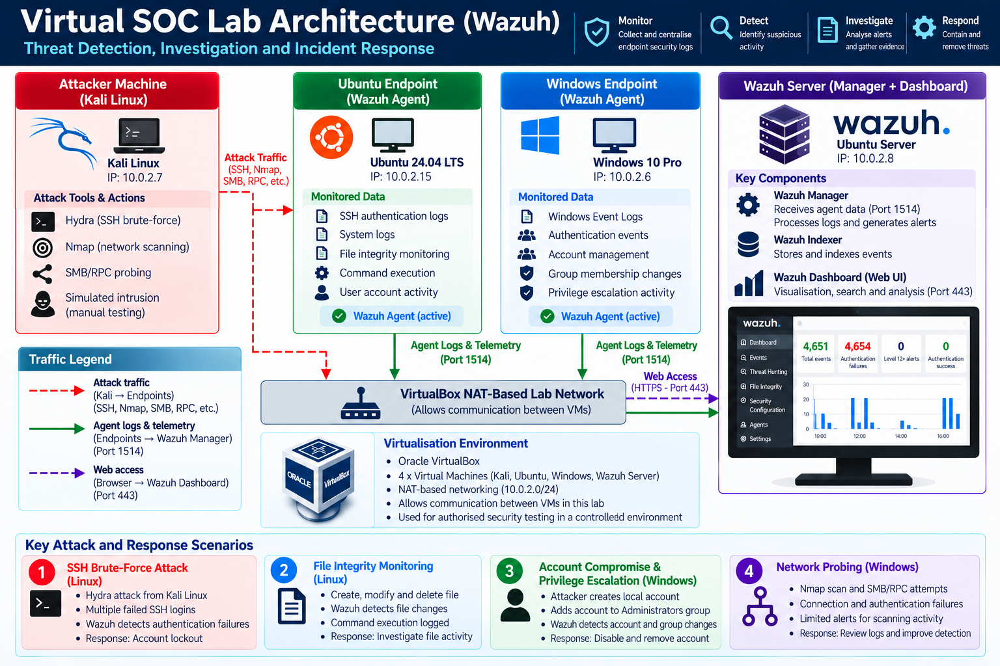

*Figure 1. Virtual SOC architecture showing controlled attack traffic, monitored endpoints and centralised Wazuh analysis.*

### Monitoring Workflow

1. Kali Linux generated controlled test activity against the Ubuntu and Windows endpoints.
2. Wazuh agents collected supported endpoint logs and security events.
3. The Wazuh Manager processed incoming telemetry and generated alerts according to configured detection rules.
4. The Wazuh Dashboard provided visibility into events, alert severity and relevant log details.
5. Alerts were investigated and appropriate manual containment actions were performed.

## 2. Wazuh Deployment and Endpoint Monitoring

Wazuh was deployed on an Ubuntu Server virtual machine, with agents configured on the Ubuntu workstation and Windows 10 endpoint.

The agents enabled centralised monitoring of Linux and Windows security activity.

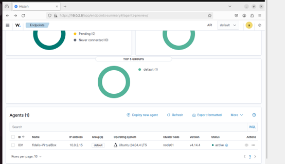

*Figure 2. Ubuntu endpoint registered with Wazuh and reporting an active connection as Agent ID 001.*

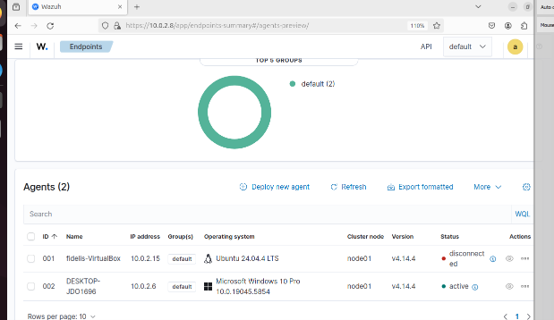

*Figure 3. Windows 10 endpoint reporting an active Wazuh agent connection.*

Agent status was checked during testing. An additional dashboard capture showed Ubuntu disconnected at a different point in the exercise; this was not treated as proof that the agent remained continuously connected.

## 3. Detection Scenario — SSH Brute-Force Activity

### Objective

Evaluate whether Wazuh could identify repeated SSH authentication failures against the monitored Ubuntu endpoint.

### Test Execution

Hydra was used from Kali Linux to generate repeated SSH authentication attempts against the Ubuntu workstation.

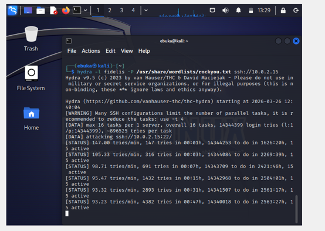

*Figure 4. Controlled SSH authentication testing from Kali Linux against the Ubuntu endpoint.*

### Detection and Investigation

Wazuh recorded a substantial volume of authentication-related events during the test.

The dashboard displayed 4,654 authentication failures within the selected monitoring view.

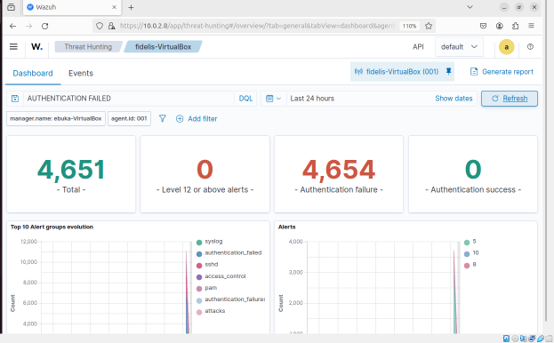

*Figure 5. Wazuh dashboard displaying authentication-failure activity associated with the SSH test.*

Further investigation of the event records identified failed authentication messages, Wazuh rule identifiers and associated severity levels.

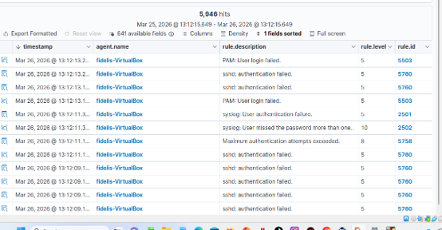

*Figure 6. Authentication-related alerts, including SSH login failures and maximum authentication attempt warnings.*

Detailed log inspection identified the source address `10.0.2.7`, corresponding to the Kali Linux machine.

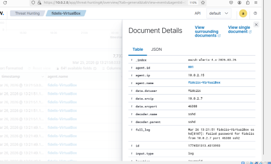

*Figure 7. Wazuh event details identifying the source IP address and failed SSH authentication activity.*

### Response

Following the investigation, the targeted Ubuntu account was manually locked as a containment measure.

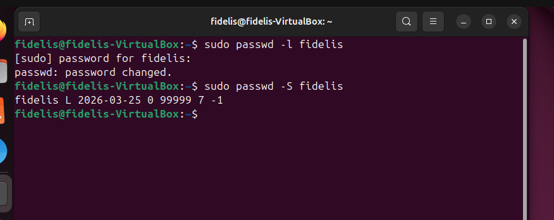

*Figure 8. Manual account lockout using Linux account-management commands, followed by a status check.*

**Outcome:** Wazuh provided visibility into repeated SSH authentication failures, supporting investigation of the originating host and subsequent manual containment.

## 4. Detection Scenario — Linux File Integrity and Command Activity

### Objective

Evaluate visibility into changes affecting a monitored file on the Ubuntu endpoint.

### Test Execution

A test file named `important_file.txt` was created in the Ubuntu user's home directory and subjected to file activity, including deletion.

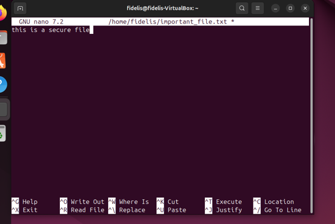

*Figure 9. Test file activity performed on the monitored Ubuntu endpoint.*

### Monitoring and Investigation

Wazuh File Integrity Monitoring displayed file metadata, including its path, ownership, permissions and cryptographic hashes.

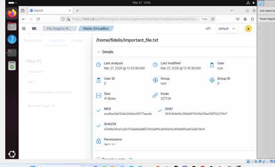

*Figure 10. Wazuh file inventory displaying metadata and integrity information for the monitored file.*

A separate Wazuh event recorded the privileged command used to remove the file.

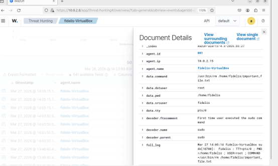

*Figure 11. Wazuh event details showing the recorded `sudo rm` command targeting the monitored file.*

**Outcome:** The exercise demonstrated file inventory visibility and investigation of related command activity. The inventory and command-log screenshots provide different types of evidence and should not be interpreted as identical detections.

## 5. Detection Scenario — Windows Authentication and Network Probing

### Objective

Examine how Windows security events generated during controlled authentication and network-access testing appeared in Wazuh.

### Test Execution

Kali Linux was used to attempt SMB and RPC connections against the Windows 10 endpoint.

The tests produced connection errors and authentication failures.

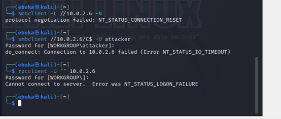

*Figure 12. Controlled SMB/RPC connection and authentication attempts from Kali Linux.*

### Detection and Investigation

Wazuh displayed Windows authentication-failure alerts, including events associated with Windows Security Event ID 4625.

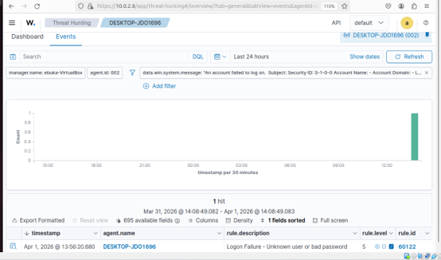

*Figure 13. Windows authentication-failure activity visible through Wazuh.*

Detailed event information identified the source network address `10.0.2.7` and workstation name `KALI`.

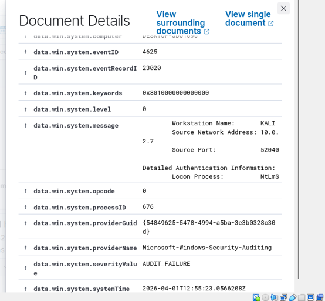

*Figure 14. Windows Event ID 4625 showing a failed logon and associated source information.*

**Outcome:** Windows authentication telemetry provided useful evidence of failed access attempts. However, the broader network reconnaissance tests did not consistently produce high-priority Wazuh alerts.

This highlighted a detection-coverage limitation: endpoint authentication logging does not automatically provide complete visibility into network scanning activity.

## 6. Detection Scenario — Windows Account Compromise and Privilege Escalation

### Objective

Evaluate whether Wazuh could detect suspicious Windows account creation, account enablement and local privilege escalation activity on the Windows 10 endpoint.

### Test Execution

This scenario simulated an attacker who had gained access to a Windows 10 endpoint and attempted to establish privileged access.

A local test account named `attacker` was created to simulate unauthorised account activity. The account was subsequently added to the local Administrators group, representing a privilege escalation attempt.

The initial access was assumed as part of the controlled simulation. The testing focused on detecting account-management and privilege changes through Windows security events collected by Wazuh.

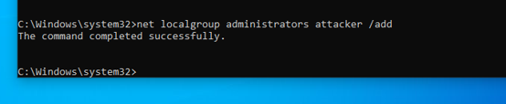

*Figure 15. Successful addition of the simulated attacker account to the Windows local Administrators group, demonstrating a privilege escalation scenario.*

### Detection and Investigation

Wazuh displayed multiple account-management alerts, including:

- Account enablement or creation-related activity
- User account changes
- Local group membership changes
- Administrators group modifications

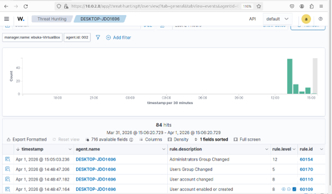

*Figure 16. Wazuh alerts associated with Windows account-management and group-change activity.*

A detailed Windows event also recorded that a user account had been enabled.

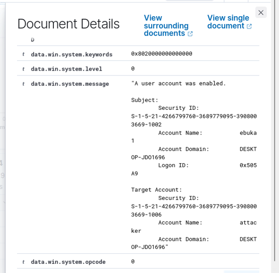

*Figure 17. Windows Security event details documenting account enablement.*

### Response

Following investigation, the test account was manually disabled and subsequently removed.

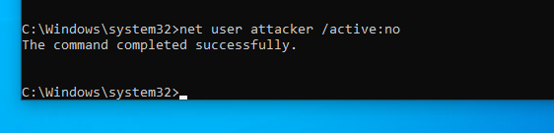

*Figure 18. Manual containment by disabling the Windows test account.*

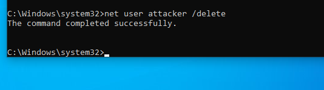

*Figure 19. Removal of the test account following the controlled investigation.*

**Outcome:** Wazuh provided visibility into Windows account-management and privilege-related events, supporting the investigation and manual containment of the test account.

## 7. Testing Results and Evaluation

| Scenario | Observed Result | Evaluation |
| --- | --- | --- |
| SSH authentication testing | Repeated failed logins recorded by Wazuh | Successful detection of authentication activity |
| Linux file monitoring | File metadata and associated command activity available | Useful visibility, with evidence-source limitations |
| Windows failed authentication | Event ID 4625 and source information recorded | Successful collection of relevant Windows security telemetry |
| Windows account changes | Account and administrator-group alerts generated | Successful monitoring of security-relevant account activity |
| Network reconnaissance | Limited high-priority alerts during scanning tests | Detection gap requiring additional monitoring or rules |
| Manual incident response | Linux account locked; Windows account disabled and removed | Containment actions demonstrated |

### Key Limitations

- The environment was a small academic lab rather than a production enterprise SOC.
- The NAT-based virtual network was designed for test connectivity, not enterprise-grade segmentation.
- Detection coverage depended on the logs collected and Wazuh rules available.
- Network scanning did not consistently generate high-priority alerts.
- Response actions were performed manually; automated containment and SOAR orchestration were not implemented.
- Testing demonstrated selected scenarios rather than comprehensive attack coverage.

## 8. Skills Demonstrated

- Security monitoring and SIEM administration
- Wazuh Manager and endpoint agent deployment
- Linux and Windows security event analysis
- SSH authentication and failed-logon investigation
- File integrity and system-command monitoring
- Windows account and privilege-change investigation
- Alert triage and interpretation of log details
- Source IP and event correlation
- Manual incident containment and account management
- Detection testing, evaluation and technical reporting

## 9. Lessons Learned and Future Improvements

This project strengthened my understanding of how a SOC uses centralised security telemetry to identify suspicious activity, investigate alerts and support incident response.

It also demonstrated that successful log collection does not guarantee comprehensive detection. Some activities produced clear security alerts, while network reconnaissance revealed opportunities to improve monitoring coverage.

Future improvements could include:

- Network segmentation and more realistic enterprise architecture
- Additional endpoint and network telemetry sources
- Custom Wazuh detection rules and improved alert correlation
- MITRE ATT&CK mapping for tested techniques
- More structured incident investigation and evidence documentation
- Evaluated automated response and SOAR integration

These lessons have informed my subsequent work on a separate enterprise infrastructure lab.

## 10. Ethics and Project Scope

All tests were performed within an authorised academic environment using controlled virtual machines.

The project did not involve unauthorised testing of external systems. Screenshots illustrate lab activities and security events, and response actions were performed manually unless otherwise stated.

This repository documents an educational security operations project and does not represent professional SOC employment or a production deployment.

